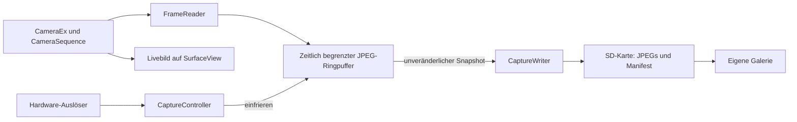

# GhostBuffer: Entwicklungsplan für die Sony A5000

Stand: 14. Oktober 2026. Grundlage: das vorhandene PMCADemo-Projekt und die unten verlinkten Primärquellen. Dieses Dokument beschreibt einen vorgeschlagenen Aufbau; es liegen keine eigenen Messungen oder Kompatibilitätstests auf einer A5000 vor.

**Ziel:** Eine eigenständige Kamera-App hält fortlaufend komprimierte Livebild-JPEGs im Arbeitsspeicher. Ein Druck auf den Auslöser sichert die Bilder vor dem Druck auf die SD-Karte. Zunächst soll ein einziges nachweislich gültiges Livebild-JPEG auf der A5000 entstehen. Alle weiteren Arbeiten hängen von diesem Nachweis ab.

## 1. Was bereits belegt ist und was wir prüfen müssen

Ein Entwickler beschreibt im OpenMemories-Framework-Issue vom 2. Juli 2021 einen funktionierenden JPEG-Livebildzugriff auf der **ILCE-6000** über `CameraSequence`. Genannt werden 640 × 480 Pixel, JPEGs unter 100 KB, Polling über `getPreviewSequenceFrames(1)` und ein direkter `ByteBuffer`. Der normale Android-PreviewCallback funktionierte in seinem Versuch nicht. Das ist ein Erfahrungsbericht für die A6000, keine A5000-Kompatibilitätszusage. [Live-preview-Bericht](https://github.com/ma1co/OpenMemories-Framework/issues/35).

Die Framework-Stubs enthalten `open`, `startPreviewSequence`, `getPreviewSequenceFrames`, `stopPreviewSequence` und `release`. Die Options-Stubs besitzen passende Vorschau- und JPEG-Schlüssel sowie `setOption`-Überladungen. Stubs beschreiben Signaturen; sie liefern weder die Sony-Implementierung noch einen Nachweis für eine bestimmte Kamera. [CameraSequence-Stubs](https://github.com/ma1co/OpenMemories-Framework/blob/master/stubs/src/main/jasmin/com/sony/scalar/hardware/CameraSequence.j), [Options-Stubs](https://github.com/ma1co/OpenMemories-Framework/blob/master/stubs/src/main/jasmin/com/sony/scalar/hardware/CameraSequence%24Options.j).

PMCA-RE ist ein Werkzeug auf dem Computer, unter anderem zur Installation eigener Apps auf unterstützten Kameras. OpenMemories: Framework ist eine Entwicklerbibliothek. OpenMemories: Tweak ist eine separate Kamera-App und kann für Diagnosezugang nützlich sein. Die Frage ist deshalb zunächst, ob auf der konkreten A5000 eigene Apps installiert und gestartet werden können; nicht, ob „PMCA-RE auf der Kamera installiert“ ist. Das PMCA-RE-Projekt verlangt für eigene Apps Kompatibilität mit Android 2.3.7. [PMCA-RE](https://github.com/ma1co/Sony-PMCA-RE), [Framework](https://github.com/ma1co/OpenMemories-Framework).

**Offene Nachweise:** Klassen und Methoden auf der A5000; akzeptierte Optionen und Einheiten; veränderliche statt wiederholter Frames; tatsächliche Bildrate und Verzögerung; Speicherbudget einschließlich nativer Puffer; Auslöser-Ereignisse; SD-Schreibzugriff; Verhalten bei Autofokus und beim Verlassen der App.

## 2. Umfang von Version 1.0

| Eigenschaft | Vorgesehener Startwert | Bedeutung |
| --- | --- | --- |
| Auflösung | 640 × 480 | Aus der A6000-Erfahrung abgeleiteter Testwert |
| Pufferdauer | 2,0 Sekunden | Zeitfenster; nicht einfach eine feste Anzahl Bilder |
| Abrufrate | zunächst 1–2, später bis 10 Hz | Abrufrate und tatsächliche neue Frames getrennt messen |
| Speicherung | JPEGs plus `manifest.json` | Keine unnötige Neukompression |
| Auslösen | voller Druck auf Hardware-Auslöser | Genau eine Sicherung pro Druck |
| Halb drücken | später Autofokus, sofern stabil | Erst mit manuellem Fokus die Datenpipeline prüfen |
| Während des Speicherns | Puffer pausiert | Version 1 hat einen Sicherungsvorgang gleichzeitig |
| Bildauswahl | eigene Galerie | Navigation über Kameratasten |
| Normalfoto, RAW, Bewegungserkennung | spätere Erweiterungen | Nicht Teil des ersten Funktionsnachweises |

Ein VGA-JPEG hat rund 0,3 Megapixel. GhostBuffer 1.0 liefert damit Vorschau-Bilder für den verpassten Moment, keine hochauflösenden rückwirkenden Sensoraufnahmen. Ein später zusätzlich ausgelöstes Normalfoto liegt zeitlich nach dem Tastendruck.

Die App puffert nur, solange sie im Vordergrund läuft, Livebild und Kamera bereit sind und der Puffer aktiv ist. Nach einem Neustart existieren keine vergangenen Frames. Während Speichern und Bildauswahl besteht in dieser Version eine Aufnahmelücke.

## 3. Was wir aus PMCADemo übernehmen

Das lokale Projekt wurde für diesen Plan gelesen, aber nicht gebaut oder auf Hardware ausgeführt.

| Vorhandene Datei | Verwendung | Erforderliche Anpassung |
| --- | --- | --- |
| `CameraActivity.java` | `CameraEx`, SurfaceView, Start des Livebilds | Sequence-Zugriff, Fehlerbehandlung und geordneter Lebenszyklus |
| `BaseActivity.java` | Sony-Scancodes für Fokus, Auslöser und Navigation | Zustandsabhängige Behandlung und Schutz vor Wiederholungen |
| `KeyEventActivity.java` | Diagnose tatsächlich gelieferter Tasten | Protokoll für A5000 erstellen |
| `Logger.java` | Muster für Pfad über `Environment.getExternalStorageDirectory()` | Fehler sichtbar machen und laufende SD-Schreibzugriffe vermeiden |
| `PlaybackActivity.java` | Beispiel für Bildlisten | Eigene Dateigalerie statt Abhängigkeit von Sonys Medienindex |
| `BitmapUtil.java` / `ScalingBitmapView.java` | Bildanzeige | Kleine Vorschauen und begrenzte Bitmap-Lebensdauer |
| `AndroidManifest.xml` | Kamera- und Speicherberechtigungen | Eigene Activities und auf den Umfang reduzierte Berechtigungen |

`CameraActivity` ruft bei vollem Druck bereits `takePicture` auf. In GhostBuffer 1.0 wird dieser Ablauf durch das Einfrieren des Puffers ersetzt. Der vorhandene `cancelTakePicture`-Aufruf beim Loslassen gehört dann ebenfalls nicht in diesen Modus.

Der aktuelle Build nutzt Android Gradle Plugin 2.2.3, SDK-Level 10, Build Tools 25.0.2, Java-6-Kompatibilität, JCenter und Framework-SNAPSHOTs. Ein Gradle-Wrapper fehlt im Checkout. Ein reproduzierbarer Build ist deshalb ein eigener erster Arbeitsschritt.

## 4. Architektur und Verantwortlichkeiten



Das Livebild bleibt möglichst auf der Kamerasurface. Wir dekodieren nicht zusätzlich jeden Frame für die Hauptanzeige.

| Baustein | Aufgabe |
| --- | --- |
| `GhostBufferActivity` | Oberfläche, Surface-Lebenszyklus und Kamera-Tasten |
| `SonyPreviewBackend` | Sony-Aufrufe und Prüfung der zur Laufzeit vorhandenen API |
| `FrameReader` | Getakteter Abruf, Validierung, Kopie, Freigabe der DeviceMemory-Objekte |
| `FrameRingBuffer` | Begrenzung nach Alter, Anzahl und Bytes; Einfrieren |
| `CaptureController` | Zustandswechsel, Auslöser-Zeitpunkt und Besitz der Puffer |
| `CaptureWriter` | Hintergrundspeicherung und erkennbare unvollständige Sitzungen |
| `CaptureManifest` | Dateiliste, Zeitbezug, Messwerte und Diagnoseinformationen |
| `GhostGalleryActivity` | Auswahl und Anzeige aus GhostBuffer-Verzeichnissen |
| `Diagnostics` | Messwerte im RAM sammeln und gesammelt exportieren |
| `FakePreviewBackend` | Reproduzierbare Frames und Fehler ohne Kamera für Logiktests |

Vorgesehene Zustände: `IDLE → INITIALIZING → BUFFERING → FROZEN → SAVING → REVIEW`. Eine bestätigte Rückkehr aus REVIEW startet einen neuen Puffer. `PAUSED` bildet den Verlust des Vordergrunds ab; `ERROR` zeigt einen konkreten Fehler mit erneuter Startmöglichkeit.

Kamera- und Sequence-Zugriffe werden serialisiert. SD-Dateischreiben läuft separat. Die UI führt keine blockierenden Frame-Leseoperationen und keine JPEG-Dateischreibvorgänge aus. Die Zustands- und Pufferübergaben bekommen eine klar definierte kurze Synchronisation.

## 5. Etappe 0: Projekt und Kamera vorbereiten

**Arbeitsschritte**

1. Modell `ILCE-5000`, Firmware, vorhandene Apps und Installationsmöglichkeit erfassen. SD-Karte und freien Speicher feststellen. Die konkreten Kameraangaben fehlen noch; sie sind Voraussetzung für den Hardwaretest, nicht für diesen Plan.
2. PMCA-RE-Version und Installationsweg dokumentieren. Den normalen App-Installationsweg verwenden; Firmware-Updater- und Service-Modus gehören nicht zum vorgesehenen App-Ansatz. Auf macOS zunächst USB-Erkennung prüfen und bei Problemen die dokumentierten Host-Anforderungen untersuchen.
3. PMCADemo unverändert reproduzierbar bauen. Geeignete JDK-/Gradle-Kombination ermitteln, Wrapper ergänzen, benötigte alte SDK-Werkzeuge bereitstellen und nicht mehr erreichbare Abhängigkeiten ersetzen oder lokal aus festgelegten Quellen bauen.
4. Framework und Stubs auf einen geprüften Commit fixieren. Stubs nur für die Kompilierung bereitstellen, nicht als Kamera-Implementierung in die APK packen. [Einbindungsbeispiel des Frameworks](https://github.com/ma1co/OpenMemories-Framework#how-to-use).
5. APK installieren, starten, Livebild und Tastendiagnose prüfen. Paket und Ablauf einschließlich möglicher Verpackungsschritte für den ausgewählten Installer dokumentieren.
6. Für GhostBuffer eine eigene Application-ID, einen eigenen Namen und einen eigenen Speicherordner vorsehen, sodass PMCADemo als Diagnose-App erhalten bleibt. MIT-Hinweise übernommener Quellen erhalten.

**Ergebnis:** Reproduzierbares APK, dokumentierter Installationsweg und ein Hardwareprotokoll. Ohne gestartete Kamera-App ist der nächste Abschnitt noch kein ausführbarer Hardwaretest.

## 6. Etappe 1: GhostBuffer Probe – ein echtes JPEG

Die Probe bekommt nur Livebild, Status, eine Taste zum Lesen eines Frames und Diagnoseexport.

**Ablauf**

1. Zur Laufzeit benötigte Klassen, Signaturen und Optionen prüfen. Fehlende Klassen oder Methoden mit klarer Meldung beenden. Der Sony-Zugriff liegt hinter einem Adapter, damit eine fehlende API nicht schon die ganze App beim Laden der Startoberfläche scheitern lässt.
2. Auf eine gültige Surface warten, `CameraEx` öffnen, Livebild binden und starten. Vorhandene Surface bei Wiederaufnahme und Surface-Verlust ausdrücklich behandeln.
3. `CameraSequence.open(cameraEx)` aufrufen und Optionen kontrolliert setzen. Erste Testkombination: Breite 640, Höhe 480, Formatwert 256, maximal ein Frame. Für die Sequenzrate kann zunächst die im Bericht genannte Einstellung 30000 geprüft werden; die App ruft anfangs nur 1–2-mal pro Sekunde ab. Optionen und akzeptierte Werte protokollieren. Einheiten und Kompressionsparameter nicht aus den Namen erraten.
4. `getPreviewSequenceFrames(1)` auf dem Kamera-Arbeiter aufrufen. Null, leere Arrays, ungültige Objekte und unerwartete Typen berücksichtigen. Auch überraschend weitere zurückgegebene Speicherobjekte geordnet freigeben.
5. Einen direkten ByteBuffer einmal anlegen. Mit einer begrenzten Kapazität beginnen, beispielsweise 128 KiB. Größe vor dem Lesen prüfen; größere Frames melden und verwerfen. Eine kontrollierte Vergrößerung ist erst nach Untersuchung des Speicherbudgets sinnvoll.
6. Für jeden Lesevorgang Buffer zurücksetzen, Länge und Rückgabewert prüfen und Position/Limit ausdrücklich korrekt setzen. Die genaue Bedeutung des Rückgabewertes auf Hardware ermitteln. Sony-Speicher immer im `finally` freigeben. Keine DeviceMemory-Referenz im Ring behalten. [DeviceBuffer-Signaturen](https://github.com/ma1co/OpenMemories-Framework/blob/master/stubs/src/main/jasmin/com/sony/scalar/hardware/DeviceBuffer.j).
7. JPEG-Bytes in einen eigenen Arraybereich kopieren. JPEG-Kennung prüfen und die Datei am Computer vollständig dekodieren. Ein SOI-Marker allein beweist noch kein gültiges Bild.
8. Nach beendeter Einzelprobe JPEG und Diagnosebericht nach `<SD>/GHOSTBUFFER/probe/` schreiben. Dateifehler anzeigen; nicht wie im Demo-Code stillschweigend ignorieren.
9. Zehn getrennte Abrufe mit bewegtem Motiv durchführen. Sequenz stoppen und Ressourcen geordnet freigeben. Die App erneut starten und die Probe wiederholen.

**Abnahme:** Mindestens zehn dekodierbare JPEGs aus zwei Starts, plausible tatsächliche Abmessungen und sichtbare Motivänderungen. Der Bericht enthält Firmware, gesetzte Optionen, Dateigrößen, Abrufdauer und alle Fehler. Normale Kamerabedienung funktioniert nach dem Verlassen wieder.

**Entscheidung:** Fehlt die API oder liefert keine getestete Konfiguration gültige veränderliche Frames, wird die Entwicklung des Kamera-Puffers zunächst angehalten. Options-, Berechtigungs- und Lebenszyklusfehler begrenzt untersuchen. Ein externer WLAN-/HDMI-Puffer wäre eine gesonderte Lösung mit anderem Bedienkonzept.

## 7. Etappe 2: GhostBuffer Core – zeitlich korrekter Ringspeicher

**Frame-Daten**

Ein Slot enthält JPEG-Array, gültige Länge, fortlaufende Nummer, monotone Zeit beim Abrufbeginn und beim Abrufende sowie optional eine Prüfsumme. Eine Kamerazeit dient zusätzlich als lesbare Sitzungszeit, nicht zur Berechnung der Pufferdauer. Beispielhafte Struktur: `byte[] jpeg; int length; long sequence; long readStartMs; long readEndMs`.

Die Zeitstempel beschreiben zunächst den Zugriff der App. Sie sind **keine nachgewiesenen Belichtungszeitpunkte**. Die Stubs bieten zwar `getPreviewSequenceFrameInfo`, beschreiben die Detaildaten aber nur als Bytearray. Ohne verifiziertes Format wird daraus kein Sensorzeitstempel abgeleitet. [FrameInfo-Stubs](https://github.com/ma1co/OpenMemories-Framework/blob/master/stubs/src/main/jasmin/com/sony/scalar/hardware/CameraSequence%24PreviewSequenceFrameInfo.j).

**Speicherbudget**

20 Bilder × durchschnittlich 80 KB ergeben rund 1,6 MB reine komprimierte Nutzdaten. Dazu kommen Array-Kapazitäten, Direktpuffer, Metadaten, UI, Kamera-Ressourcen und später Bitmaps. Der Gesamtbedarf ist also höher.

Für einen ersten begrenzten Pool wären 24 Slots mit je 128 KiB rund 3 MiB reservierte JPEG-Kapazität, zusätzlich ein Direktpuffer und die übrigen Ressourcen. Diese Werte sind Entwurfswerte. Vor der endgültigen Wahl Heap-Grenze, Ausgangsverbrauch und Verhalten der nativen Speicherbereiche auf der A5000 messen. Ein einzelnes vollständig dekodiertes VGA-Bild kann bei 32 Bit pro Pixel rund 1,2 MB benötigen; daher keine vollständige Bitmap-Liste im Puffer halten.

**Pufferregeln**

- Altersgrenze und Kapazität gleichzeitig anwenden. Für ein Fenster T und eine angenommene maximale Rate f mindestens `ceil(T × f) + 1` Slots als Planungsgrundlage verwenden; zusätzliche Slots bleiben ebenfalls durch ein Bytebudget begrenzt.
- Vor dem Auslöser fortlaufend Bilder entfernen, die außerhalb des aktuellen Zeitfensters liegen. Beim Einfrieren erneut gegen den Triggerzeitpunkt filtern, auch wenn inzwischen keine Frames mehr ankommen.
- Bei Speicherdruck ältere Slots entfernen oder die konfigurierte Dauer reduzieren. Die UI meldet die tatsächlich verfügbare Abdeckung.
- Nach dem Start den Füllstand anzeigen. Frühes Auslösen darf die vorhandenen Bilder sichern, muss aber einen unvollständigen Vorlauf kennzeichnen.
- Beim Ausbleiben neuer Frames keinen gefüllten Puffer als aktuelle Aufnahmebereitschaft anzeigen.

**Taktung und Messung**

Mit 2, 5 und 10 Abrufen pro Sekunde testen. Nach monotonen Zielzeiten takten; bei Verzögerungen Zeitpunkte überspringen, statt durch hektisches Nachholen Lastspitzen zu erzeugen. Gewünschte Sequenzrate, Pollingrate, erfolgreiche Abrufe und nachweislich neue Motivframes getrennt behandeln.

Pro Lauf erfassen: erfolgreiche Frames/s, leere und fehlerhafte Abrufe, JPEG-Größen, Abrufzeiten mit Median und hohem Perzentil, größte Lücke, aktuelle Zeitabdeckung und Speichertrend. Mit bewegtem Motiv Wiederholungen prüfen. Gleiche JPEGs bei einem statischen Motiv allein beweisen keine fehlerhafte Pipeline. Keine Diagnosezeile pro Frame synchron auf SD schreiben.

**Abnahme:** Zehn Minuten bei gewählter Konfiguration ohne wachsenden Speichertrend, ANR oder dauerhaften Abrufstillstand; korrekte chronologische Reihenfolge und begrenzte Bytebelegung. Ziel sind 10 FPS. Falls nur eine niedrigere Rate stabil ist, wird sie als gemessener Standard verwendet. Ein sinnvoller erster Produktwert könnte bei mindestens 5 unterschiedlichen Frames/s liegen; das ist eine vorgeschlagene Akzeptanzgrenze, kein Hardwarebefund.

## 8. Etappe 3: GhostBuffer Capture – Auslösen und konsistent sichern

**Grenze beim Tastendruck**

Beim ersten gültigen vollen Druck hält der Controller einen monotonen Triggerzeitpunkt fest und friert den Ring atomar ein. Alle neuen Inserts werden für diese Puffergeneration gesperrt. Bereits kopierte JPEG-Slots werden an den Writer übergeben; sie werden bis Abschluss oder bewusstem Verwerfen nicht wiederverwendet.

Ein gerade laufender Sony-Abruf darf noch geordnet enden. Er darf den eingefrorenen Snapshot nicht verändern. Als konservative Regel werden nur Frames berücksichtigt, deren Abruf vor dem aufgezeichneten Trigger abgeschlossen war. Ob ein später abgeholter Frame tatsächlich vor dem Druck belichtet wurde, ist ohne Kamerazeitstempel unbekannt.

Das Fenster lautet zunächst `triggerMs − bufferDurationMs ≤ readEndMs ≤ triggerMs`. Es beschreibt App-Abrufzeiten. Eingabeverzögerung und Kamerapipeline-Latenz werden separat gemessen, beispielsweise mit einer sichtbar laufenden Uhr und Bewegung im Bild. Absolute Zusagen zum Belichtungszeitpunkt erfordern weitere Hardwarebelege.

Gedrückthalten und Key-Repeats erzeugen keine zweite Sitzung. Erst Loslassen und erneuter gültiger Druck ermöglichen eine neue Sicherung. Fokus-Tasten und Schließen der App bekommen zustandsabhängige Regeln. Für die ersten Versuche manuellen Fokus verwenden, danach Autofokus separat prüfen.

**Dateiformat**

```text
<SD>/GHOSTBUFFER/
  captures/
    20261014_153000_001/
      frame_000001.jpg
      frame_000002.jpg
      ...
      manifest.json
      COMPLETE
  diagnostics/
  probe/
```

Verzeichnisse kollisionsfrei anlegen und vorhandene Dateien niemals überschreiben. Während des Schreibens fehlt `COMPLETE`. JPEGs zunächst temporär schreiben, schließen und innerhalb desselben Dateisystems umbenennen; Ergebnisse prüfen. Das Manifest zuletzt vervollständigen, Dateien soweit verfügbar synchronisieren und danach den Abschlussmarker setzen. So erkennt die Galerie unterbrochene Sitzungen. Der Marker ist keine Garantie gegen jede Stromunterbrechung oder SD-Controller-Eigenheit.

Das Manifest enthält Schema- und App-Version, Modell/Firmware, lesbare Kamerazeit, monotone Triggerzeit innerhalb der Sitzung, gewünschte und tatsächliche Pufferdauer, Messrate, Auflösung, gesetzte Optionen und eine geordnete Dateiliste. Je Frame werden Größe und Zeitdifferenz zum Trigger gespeichert, optional zusätzlich eine Prüfsumme. Belichtungsdaten oder EXIF-Werte nur aufnehmen, wenn tatsächlich verfügbar; keine Werte erfinden.

**Fehlerverhalten**

Vorher freien Speicher, Schreibbarkeit und Kartenstatus prüfen. Während des Schreibens alle Fehler trotzdem behandeln. Bei Kartenentnahme oder voller Karte bleibt die Sitzung sichtbar unvollständig. Den eingefrorenen RAM-Snapshot möglichst bis zum Wiederholungsversuch behalten. Vor dem Rückkehr zum Puffern muss der Nutzer einen fehlgeschlagenen Snapshot bewusst verwerfen oder erfolgreich sichern. Bei Prozessende kann ungesicherter RAM verloren gehen.

**Abnahme:** 50 Sicherungen mit unterschiedlichem Füllstand und Druckdauer; keine doppelten Trigger, keine vertauschten oder nachträglich überschriebenen Frames. Alle vollständigen Sitzungen am Computer dekodierbar. Fehlende, volle oder entfernte Karte führt zu sichtbarem Fehler und keiner falschen Erfolgsmeldung. Ein kontrolliert unterbrochener Schreibvorgang wird beim nächsten Start als unvollständig erkannt.

## 9. Etappe 4: Oberfläche und Galerie

Die Aufnahmeansicht zeigt Livebild, Status, Ziel- und gemessene Rate, verfügbare Pufferdauer und Frameanzahl. Beispielsweise: `PUFFER AKTIV | 1,8 s | 18 Bilder | 9,5 FPS`. Gemessene Werte erst nach ausreichender Beobachtung anzeigen; bis dahin „wird gemessen“.

Vorgesehene Tastenbelegung: voller Auslöser sichert; halber Auslöser fokussiert nach erfolgreichem AF-Test; Richtungstasten wählen in der Galerie; Mitte öffnet das Bild oder startet den nächsten Puffer; die verifizierte Zurück-/Löschtaste verlässt den aktuellen Bildschirm. Endgültig nur tatsächlich vorhandene A5000-Tasten belegen.

Beim Speichern einen Fortschritt zeigen und weitere Trigger sperren. Eine zweisekündige Mindestfüllung ist kein Zwang: frühe Sicherungen bleiben möglich und werden als kürzer markiert. Nach längeren Frame-Ausfällen „Livebild-Puffer unterbrochen“ anzeigen.

Die Galerie liest die eigenen Manifest-Dateien. Dass handgeschriebene JPEGs in Sonys normaler Wiedergabe erscheinen, wird nicht vorausgesetzt. Kleine Thumbnails nur für sichtbare Einträge dekodieren; wenige Bitmaps behalten. Eine ausgewählte Originaldatei separat öffnen. Auswahl zunächst im Manifest markieren, ohne die restlichen Frames automatisch zu löschen.

**Abnahme:** Alle Kernabläufe sind mit Kameratasten erreichbar. Speichern blockiert die Bedienoberfläche nicht. Wiederholtes Öffnen und Verlassen der Galerie erzeugt keinen Speichertrend. Jede Auswahl zeigt Reihenfolge und Zeitabstand zum Trigger verständlich an.

## 10. Lebenszyklus und blockierende Aufrufe

Bei Surface-Verlust, `onPause` und App-Ende zunächst weitere Aufnahmeaufträge sperren. Der Besitzer der Sony-Ressourcen beendet laufende Arbeiten, gibt alle DeviceMemory-Objekte frei und stoppt anschließend Sequenz, Preview und Kamera in geprüfter Reihenfolge. Ressourcen werden nicht auf dem UI-Thread freigegeben, während ein anderer Thread darin liest.

Die Pause fordert das Ende asynchron an; kein unbegrenztes `join` auf dem UI-Thread. Späte Callbacks dürfen keine alte Activity bedienen. Erneutes Öffnen erst nach abgeschlossener Freigabe. Bei fehlgeschlagenem Öffnen nur tatsächlich erworbene Ressourcen freigeben.

Ein Java-Timeout beendet keine beliebig blockierende native Sony-Methode. Bereits die Probe muss deshalb messen, ob Abrufe bei gestopptem Livebild und beim Verlassen zurückkehren. Ein Watchdog meldet einen Stillstand, startet aber keine unbegrenzt vielen Ersatzthreads. Bleibt ein Aufruf nicht geordnet abbrechbar, ist ein belastbarer Wiederherstellungsweg auf Hardware erforderlich, bevor das Produkt freigegeben wird.

## 11. Prüfstrategie

| Bereich | Ohne Kamera prüfbar | Hardware erforderlich |
| --- | --- | --- |
| Ringpuffer | Alter, Kapazität, Reihenfolge, Wraparound, früher Trigger | Speicherbudget und Dauerbetrieb |
| Trigger | genau ein Snapshot, laufender Insert, generationenübergreifende Callbacks | Scancodes und tatsächliche Eingabeverzögerung |
| Writer | volle Karte simulieren, kurze/abgebrochene Writes, unvollständige Sitzung | SD-Verhalten und Schreibzeiten |
| Galerie | Manifest, beschädigte Dateien, begrenzte Dekodierung | Display und Kameratasten |
| Sony-Adapter | simulierte leere/fehlerhafte Rückgaben | Klassen, Optionen, neue JPEGs, Blockierverhalten |
| Normalfoto später | Controller-Ablauf | Preview-Unterbrechung, Fokus, Speicherung und Wiederaufnahme |

Die wichtigen Logiktests laufen mit Fake-Frames und kontrollierter Uhr. Ein Android-Emulator mit Stubs kann Oberflächen und Abläufe prüfen, aber keine Sony-Kamerafunktion bestätigen. Für die fertige Version folgt ein Lauf über mindestens 30 Minuten mit wiederholten Sicherungen, Pause/Wiederaufnahme und dokumentiertem Speicherverlauf. Akkuverbrauch und Erwärmung unter gleichen Bedingungen mit gewöhnlichem Livebildbetrieb vergleichen.

## 12. Konkrete Arbeitspakete und Aufwand

Die Schätzungen sind reine Entwicklungszeit für eine Person bei regelmäßig verfügbarer Kamera. Installationsprobleme, Beschaffung alter Build-Artefakte und neues Reverse Engineering können den Aufwand erheblich verlängern.

| Reihenfolge | Arbeitspaket | Aufwand | Fertig, wenn |
| --- | --- | --- | --- |
| 1 | Build, feste Abhängigkeiten, Installation und Tastendiagnose | 1–3 Tage | Demo reproduzierbar startet |
| 2 | API-Prüfung und Probe mit JPEG/Diagnoseexport | 1–3 Tage | Gültige veränderliche A5000-JPEGs nachgewiesen |
| 3 | Zeitpuffer, begrenzter Pool und Messläufe | 2–4 Tage | Stabile gewählte Rate und korrekte Zeitfenster |
| 4 | Trigger, Snapshot und SD-Sitzungsformat | 2–4 Tage | Wiederholbar vollständige Sicherungen und klare Fehler |
| 5 | Statusanzeige und Galerie | 2–4 Tage | Bedienbarer Gesamtablauf |
| 6 | Lebenszyklus, Dauertests und Release-Dokumentation | 2–5 Tage | Hardware-Abnahme bestanden |

Gesamter Rahmen unter günstigen Bedingungen: **10–23 Arbeitstage**. Ein erster Einzelbild-Nachweis kann deutlich früher vorliegen. Ohne erfolgreiche Probe ist der Aufwand für ein fertiges Produkt nicht belastbar schätzbar.

Vorgesehene Dateien im eigenständigen Projekt: `preview/SonyPreviewBackend.java`, `preview/FrameReader.java`, `buffer/FrameRingBuffer.java`, `capture/CaptureController.java`, `capture/CaptureWriter.java`, `capture/CaptureManifest.java`, `ui/GhostBufferActivity.java`, `ui/GhostGalleryActivity.java` und passende Ressourcen. Java und einfache, mit dem ermittelten alten Android kompatible APIs verwenden; keine ungetestete moderne Android-Laufzeit voraussetzen.

Release-Ergebnis: installierbare APK, fixierter Quellstand, Build-/Installationsanleitung, A5000-Testbericht mit Firmware, geprüfte Standardkonfiguration und dokumentierte Einschränkungen. Änderungen am Firmware-Image sind für diesen vorgesehenen App-Ansatz kein Arbeitspaket.

## 13. Erweiterungen nach Version 1.0

**Einstellbare Dauer und Rate:** Nur auf Hardware geprüfte Kombinationen anbieten. Jede Kombination gegen Bytebudget prüfen. Ein längerer Puffer darf nicht stillschweigend den Heap überfordern.

**Zusätzliches Normalfoto:** Erst den Vorlauf einfrieren, dann den dokumentierten Normalfoto-Ablauf auslösen. Prüfen, ob PreviewSequence vorher gestoppt werden muss und wie Preview danach wieder startet. Vorlauf und Normalfoto gemeinsam referenzieren, jedoch mit ihrer tatsächlichen unterschiedlichen Auflösung und Zeitlage. RAW nur aufnehmen, wenn der separate Kamera-Aufnahmepfad es nachweislich unterstützt.

**Nachlauf:** Optional nach dem Trigger weitere Frames sammeln. Dafür getrennte Grenzen und Snapshot-Regeln definieren; den bewährten reinen Vorlaufmodus erhalten.

**Puffern während Speicherung:** Erst bei ausreichendem Speicher und nach stabiler Grundversion einen zweiten Pool einsetzen. Beide Pools und ausstehende Schreibjobs gemeinsam begrenzen. Bei langsamer Karte neue Sicherungen kontrolliert ablehnen.

**Bewegungserkennung:** In geringer Frequenz kleine dekodierte Graustufenbilder vergleichen. Schwellwert, mehrere aufeinanderfolgende Treffer und eine Sperrzeit verwenden. Autofokusänderungen, Belichtungssprünge und Kamerabewegung als mögliche Fehlauslöser testen. Die Rechenkosten zuerst messen.

**Bessere Bildauswahl:** Später einfache Schärfe- oder Bewegungsbewertungen erproben. Alle Original-JPEGs zunächst erhalten; automatische Bewertungen ersetzen keine erfolgreiche Aufzeichnung.

Der erste konkrete Implementierungsauftrag bleibt: **GhostBuffer Probe installieren, genau einen Livebild-Frame auf der A5000 lesen, als JPEG exportieren und unabhängig dekodieren.** Danach entscheiden die Messungen über Rate, Speicherausstattung und die Freigabe der nächsten Etappe.
