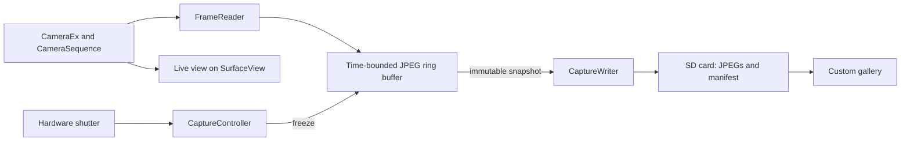

# GhostBuffer: Development Plan for the Sony A5000

Date: 14 October 2026. Based on the existing PMCADemo project and the primary sources linked below. This document describes a proposed design; no first-hand measurements or compatibility tests on an A5000 were available when it was written.

**Goal:** A standalone camera app continuously keeps compressed live-view JPEGs in memory. Pressing the shutter saves the images preceding that press to the SD card. The first milestone is a single demonstrably valid live-view JPEG on the A5000. All subsequent work depends on that evidence.

## 1. Existing evidence and required checks

In an OpenMemories-Framework issue dated 2 July 2021, a developer describes working JPEG live-view access on the **ILCE-6000** through `CameraSequence`. The report mentions 640 × 480 pixels, JPEGs below 100 KB, polling through `getPreviewSequenceFrames(1)` and a direct `ByteBuffer`. The normal Android PreviewCallback did not work in that experiment. This is an A6000 experience report, not an A5000 compatibility guarantee. [Live-preview report](https://github.com/ma1co/OpenMemories-Framework/issues/35).

The framework stubs contain `open`, `startPreviewSequence`, `getPreviewSequenceFrames`, `stopPreviewSequence` and `release`. The options stubs provide corresponding preview and JPEG keys and `setOption` overloads. Stubs describe signatures; they provide neither Sony's implementation nor proof of support on a specific camera. [CameraSequence stubs](https://github.com/ma1co/OpenMemories-Framework/blob/master/stubs/src/main/jasmin/com/sony/scalar/hardware/CameraSequence.j), [Options stubs](https://github.com/ma1co/OpenMemories-Framework/blob/master/stubs/src/main/jasmin/com/sony/scalar/hardware/CameraSequence%24Options.j).

PMCA-RE is a desktop tool that can, among other things, install custom apps on supported cameras. OpenMemories: Framework is a developer library. OpenMemories: Tweak is a separate camera app that can help with diagnostic access. The initial question is therefore whether custom apps can be installed and launched on the particular A5000, rather than whether “PMCA-RE is installed on the camera.” The PMCA-RE project requires custom apps to be compatible with Android 2.3.7. [PMCA-RE](https://github.com/ma1co/Sony-PMCA-RE), [Framework](https://github.com/ma1co/OpenMemories-Framework).

**Evidence still needed:** Classes and methods on the A5000; accepted options and units; changing rather than repeated frames; actual frame rate and latency; memory budget including native buffers; shutter events; SD write access; behavior during autofocus and when leaving the app.

## 2. Scope of version 1.0

| Property | Proposed initial value | Meaning |
| --- | --- | --- |
| Resolution | 640 × 480 | Test value derived from the A6000 report |
| Buffer duration | 2.0 seconds | Time window, not merely a fixed number of images |
| Polling rate | Initially 1–2, later up to 10 Hz | Measure polling rate and actual new frames separately |
| Storage | JPEGs plus `manifest.json` | No unnecessary recompression |
| Trigger | Full press of the hardware shutter | Exactly one save per press |
| Half press | Autofocus later, if stable | First validate the data pipeline with manual focus |
| During saving | Buffer paused | Version 1 permits one save operation at a time |
| Image selection | Custom gallery | Navigation through camera buttons |
| Normal photo, RAW, motion detection | Later extensions | Outside the initial proof of operation |

A VGA JPEG contains roughly 0.3 megapixels. GhostBuffer 1.0 therefore provides preview images of a missed moment, not retrospective high-resolution sensor captures. An additional normal photo triggered afterward occurs after the button press.

The app buffers only while it is in the foreground, live view and camera are ready, and the buffer is active. No past frames exist after a restart. This version has a capture gap during saving and image selection.

## 3. Components reused from PMCADemo

The local project was read for this plan but was not built or run on hardware as part of writing it.

| Existing file | Use | Required changes |
| --- | --- | --- |
| `CameraActivity.java` | `CameraEx`, SurfaceView, live-view startup | Sequence access, error handling and orderly lifecycle |
| `BaseActivity.java` | Sony scan codes for focus, shutter and navigation | State-dependent handling and repeat protection |
| `KeyEventActivity.java` | Diagnose actual button events | Produce an A5000 test log |
| `Logger.java` | Path pattern using `Environment.getExternalStorageDirectory()` | Make errors visible and avoid continuous SD writes |
| `PlaybackActivity.java` | Image-list example | Custom file gallery instead of reliance on Sony's media index |
| `BitmapUtil.java` / `ScalingBitmapView.java` | Image display | Small previews and bounded bitmap lifetimes |
| `AndroidManifest.xml` | Camera and storage permissions | Custom activities and permissions limited to the scope |

`CameraActivity` already calls `takePicture` on a full press. GhostBuffer 1.0 replaces that flow with freezing the buffer. The existing `cancelTakePicture` call on release also does not belong in this mode.

At the time of this plan, the build used Android Gradle Plugin 2.2.3, SDK level 10, Build Tools 25.0.2, Java 6 compatibility, JCenter and framework SNAPSHOTs. The checkout lacked a Gradle wrapper. Establishing a reproducible build was therefore a separate first step.

## 4. Architecture and responsibilities



Keep live view on the camera surface where possible. Do not additionally decode every frame for the main display.

| Component | Responsibility |
| --- | --- |
| `GhostBufferActivity` | UI, surface lifecycle and camera buttons |
| `SonyPreviewBackend` | Sony calls and runtime API availability checks |
| `FrameReader` | Scheduled polling, validation, copying and releasing DeviceMemory objects |
| `FrameRingBuffer` | Bounds by age, count and bytes; freezing |
| `CaptureController` | State transitions, trigger time and buffer ownership |
| `CaptureWriter` | Background saving and recognizable incomplete sessions |
| `CaptureManifest` | File list, time reference, measurements and diagnostics |
| `GhostGalleryActivity` | Selection and display from GhostBuffer directories |
| `Diagnostics` | Collect measurements in RAM and export them in batches |
| `FakePreviewBackend` | Reproducible frames and errors without a camera for logic tests |

Proposed states: `IDLE → INITIALIZING → BUFFERING → FROZEN → SAVING → REVIEW`. A confirmed return from REVIEW starts a new buffer. `PAUSED` represents loss of foreground status; `ERROR` shows a specific error with an option to restart.

Serialize camera and sequence access. SD file writing runs separately. The UI performs no blocking frame reads or JPEG writes. State and buffer handoffs use clearly defined, short synchronization.

## 5. Stage 0: Prepare the project and camera

**Steps**

1. Record model `ILCE-5000`, firmware, existing apps and installation capability. Check the SD card and free space. Specific camera details are still missing; they are prerequisites for hardware testing, not for this plan.
2. Document PMCA-RE version and installation method. Use the normal app installation path; firmware updater and service modes are outside the intended app approach. On macOS, check USB detection first and investigate documented host requirements if problems occur.
3. Build unchanged PMCADemo reproducibly. Determine a suitable JDK/Gradle combination, add the wrapper, provide the required old SDK tools and replace unavailable dependencies or build them locally from pinned sources.
4. Pin framework and stubs to a verified commit. Provide stubs for compilation only; do not package them as camera implementations in the APK. [Framework integration example](https://github.com/ma1co/OpenMemories-Framework#how-to-use).
5. Install and launch the APK; check live view and button diagnostics. Document the package and workflow, including any packaging steps required by the selected installer.
6. Give GhostBuffer its own application ID, name and storage folder so PMCADemo can remain available as a diagnostic app. Preserve MIT notices in reused sources.

**Result:** Reproducible APK, documented installation method and a hardware test log. Until a camera app has successfully launched, the next section is not yet an executable hardware test.

## 6. Stage 1: GhostBuffer Probe – one real JPEG

The probe provides only live view, status, a button to read one frame and diagnostic export.

**Procedure**

1. Check required classes, signatures and options at runtime. Stop with a clear message if classes or methods are missing. Put Sony access behind an adapter so a missing API does not crash the entire app while loading the initial UI.
2. Wait for a valid surface, open `CameraEx`, bind live view and start it. Explicitly handle an existing surface on resume and surface loss.
3. Call `CameraSequence.open(cameraEx)` and configure options deliberately. Initial test combination: width 640, height 480, format value 256, maximum one frame. Initially test the reported sequence-rate setting of 30000; the app polls only 1–2 times per second at first. Log options and accepted values. Do not infer units or compression parameters from their names.
4. Call `getPreviewSequenceFrames(1)` on the camera worker. Handle null, empty arrays, invalid objects and unexpected types. Also release any unexpectedly returned additional memory objects in an orderly way.
5. Allocate a direct ByteBuffer once. Begin with a bounded capacity, such as 128 KiB. Check size before reading; report and discard larger frames. Consider controlled growth only after investigating the memory budget.
6. Reset the buffer for every read, check length and return value, and explicitly set position/limit correctly. Determine the exact meaning of the return value on hardware. Always release Sony memory in `finally`. Do not retain DeviceMemory references in the ring. [DeviceBuffer signatures](https://github.com/ma1co/OpenMemories-Framework/blob/master/stubs/src/main/jasmin/com/sony/scalar/hardware/DeviceBuffer.j).
7. Copy JPEG bytes into an owned array region. Check the JPEG signature and fully decode the file on a computer. An SOI marker alone does not prove a valid image.
8. After the single-frame probe finishes, write the JPEG and diagnostic report to `<SD>/GHOSTBUFFER/probe/`. Display file errors instead of silently ignoring them as the demo code does.
9. Perform ten separate reads with a moving subject. Stop the sequence and release resources in order. Restart the app and repeat the probe.

**Acceptance:** At least ten decodable JPEGs across two starts, plausible actual dimensions and visible subject changes. The report includes firmware, configured options, file sizes, read duration and all errors. Normal camera operation works again after leaving the app.

**Decision:** If the API is missing or no tested configuration provides valid changing frames, pause development of the camera buffer. Investigate option, permission and lifecycle errors within a bounded effort. An external Wi-Fi/HDMI buffer would be a separate solution with a different interaction model.

## 7. Stage 2: GhostBuffer Core – a temporally correct ring buffer

**Frame data**

A slot contains a JPEG array, valid length, sequence number, monotonic read-start and read-end times, and optionally a checksum. Camera wall-clock time additionally provides a readable session timestamp; it is not used to calculate buffer duration. Example structure: `byte[] jpeg; int length; long sequence; long readStartMs; long readEndMs`.

These timestamps initially describe app access. They are **not verified exposure times**. The stubs provide `getPreviewSequenceFrameInfo`, but describe the detailed data only as a byte array. Do not derive sensor timestamps without a verified format. [FrameInfo stubs](https://github.com/ma1co/OpenMemories-Framework/blob/master/stubs/src/main/jasmin/com/sony/scalar/hardware/CameraSequence%24PreviewSequenceFrameInfo.j).

**Memory budget**

20 images × an average of 80 KB yield roughly 1.6 MB of compressed payload. Array capacities, direct buffers, metadata, UI, camera resources and eventually bitmaps add to that amount. Total usage is therefore higher.

An initial bounded pool of 24 slots at 128 KiB each would reserve roughly 3 MiB of JPEG capacity, plus a direct buffer and other resources. These are design values. Before choosing final values, measure heap limits, baseline usage and native memory behavior on the A5000. A single fully decoded VGA image at 32 bits per pixel can require roughly 1.2 MB; do not retain a full bitmap list in the buffer.

**Buffer rules**

- Apply age and capacity limits together. For a window T and an assumed maximum rate f, use at least `ceil(T × f) + 1` slots as a planning basis; additional slots remain subject to a byte budget.
- Continuously remove images outside the current time window before triggering. Filter again against the trigger time when freezing, even if frames have stopped arriving.
- Under memory pressure, evict older slots or reduce the configured duration. The UI reports actual available coverage.
- Show fill level after startup. An early trigger may save available images but must indicate incomplete pre-trigger coverage.
- If new frames stop arriving, do not display a full buffer as current capture readiness.

**Scheduling and measurement**

Test at 2, 5 and 10 polls per second. Schedule against monotonic target times; skip missed times after delays instead of creating load spikes by rapidly catching up. Distinguish desired sequence rate, polling rate, successful reads and demonstrably new subject frames.

For each run, record successful frames/s, empty and failed reads, JPEG sizes, median and high-percentile read times, largest gap, current time coverage and memory trend. Use a moving subject to check repeats. Identical JPEGs of a static subject alone do not prove a broken pipeline. Do not synchronously write a diagnostic line to SD for every frame.

**Acceptance:** Ten minutes at the chosen configuration without a growing memory trend, ANR or persistent read stall; correct chronological order and bounded byte usage. The target is 10 FPS. If only a lower rate is stable, use that measured rate as the default. At least 5 distinct frames/s could be a useful initial product threshold; this is a proposed acceptance criterion, not a hardware finding.

## 8. Stage 3: GhostBuffer Capture – trigger and save consistently

**Boundary at the button press**

On the first valid full press, the controller records a monotonic trigger time and atomically freezes the ring. Block all new inserts for that buffer generation. Transfer already copied JPEG slots to the writer; do not reuse them until completion or deliberate discard.

An ongoing Sony read may finish in order. It must not modify the frozen snapshot. As a conservative rule, include only frames whose read completed before the recorded trigger. Without camera timestamps, whether a frame fetched later was exposed before the press is unknown.

The initial window is `triggerMs − bufferDurationMs ≤ readEndMs ≤ triggerMs`. It describes app read times. Measure input delay and camera pipeline latency separately, for example with a visibly running clock and motion in the scene. Absolute claims about exposure timing require further hardware evidence.

Holding the shutter and key repeats must not create a second session. Only release followed by another valid press permits another save. Apply state-dependent rules to focus buttons and app exit. Use manual focus for initial experiments, then test autofocus separately.

**File format**

```text
<SD>/GHOSTBUFFER/
  captures/
    20261014_153000_001/
      frame_000001.jpg
      frame_000002.jpg
      ...
      manifest.json
      COMPLETE
  diagnostics/
  probe/
```

Create directories without collisions and never overwrite existing files. `COMPLETE` is absent while writing. First write JPEGs to temporary files, close them and rename within the same filesystem; check results. Finish the manifest last, sync files where supported and then create the completion marker. This lets the gallery recognize interrupted sessions. The marker does not guarantee protection against every power loss or SD controller behavior.

The manifest includes schema and app versions, model/firmware, readable camera time, monotonic trigger time within the session, desired and actual buffer duration, measured rate, resolution, configured options and an ordered file list. Record size and time offset from the trigger for each frame, optionally adding a checksum. Include exposure data or EXIF values only when actually available; do not invent values.

**Error behavior**

Check free space, writability and card status beforehand. Still handle every error during writing. Card removal or a full card leaves the session visibly incomplete. Keep the frozen RAM snapshot for a retry where possible. Before returning to buffering, the user must deliberately discard a failed snapshot or save it successfully. Unsaved RAM can be lost when the process ends.

**Acceptance:** 50 saves with different fill levels and press durations; no duplicate triggers, reordered frames or subsequent overwrites. All complete sessions decode on a computer. A missing, full or removed card produces a visible error and no false success message. A deliberately interrupted write is recognized as incomplete on the next launch.

## 9. Stage 4: UI and gallery

The capture view shows live view, status, target and measured rate, available buffer duration and frame count. For example: `BUFFER ACTIVE | 1.8 s | 18 frames | 9.5 FPS`. Display measured values only after sufficient observation; until then show “measuring.”

Proposed controls: full shutter press saves; half press focuses after successful AF testing; directional buttons select in the gallery; center opens the image or starts the next buffer; the verified back/delete button leaves the current screen. Final mappings must use only buttons actually present on the A5000.

Show progress while saving and block additional triggers. A minimum two-second fill is not mandatory: early saves remain possible and are marked as shorter. After extended frame outages, display “Live-view buffer interrupted.”

The gallery reads its own manifest files. Do not assume manually written JPEGs appear in Sony's normal playback. Decode small thumbnails only for visible entries; retain few bitmaps. Open a selected original separately. Initially mark selections in the manifest without automatically deleting the remaining frames.

**Acceptance:** Every core flow is accessible through camera buttons. Saving does not block the UI. Repeatedly opening and leaving the gallery does not produce a memory growth trend. Each selection clearly shows order and time offset from the trigger.

## 10. Lifecycle and blocking calls

On surface loss, `onPause` and app exit, first block further capture requests. The owner of Sony resources finishes ongoing work, releases all DeviceMemory objects and then stops sequence, preview and camera in a verified order. Do not release resources on the UI thread while another thread is reading them.

Pause requests termination asynchronously; no unbounded `join` on the UI thread. Late callbacks must not operate on an old activity. Reopen only after release is complete. If opening fails, release only resources actually acquired.

A Java timeout does not terminate an arbitrarily blocking native Sony method. The probe must therefore measure whether reads return when live view stops or the app is left. A watchdog reports stalls but does not launch an unbounded number of replacement threads. If a call cannot be canceled in an orderly manner, a reliable hardware recovery path is required before release.

## 11. Test strategy

| Area | Testable without a camera | Hardware required |
| --- | --- | --- |
| Ring buffer | Age, capacity, order, wraparound, early trigger | Memory budget and continuous operation |
| Trigger | Exactly one snapshot, ongoing insert, callbacks across generations | Scan codes and actual input delay |
| Writer | Simulated full card, short/interrupted writes, incomplete session | SD behavior and write times |
| Gallery | Manifest, damaged files, bounded decoding | Display and camera buttons |
| Sony adapter | Simulated empty/error returns | Classes, options, new JPEGs, blocking behavior |
| Normal photo later | Controller flow | Preview interruption, focus, saving and resume |

Important logic tests use fake frames and a controlled clock. An Android emulator with stubs can test UI and flows, but cannot establish Sony camera operation. The finished version requires a run of at least 30 minutes with repeated saves, pause/resume and documented memory usage. Compare battery consumption and heating against ordinary live view under the same conditions.

## 12. Work packages and effort

Estimates cover development time for one person with regular camera access. Installation problems, obtaining old build artifacts and new reverse engineering can significantly increase effort.

| Order | Work package | Effort | Complete when |
| --- | --- | --- | --- |
| 1 | Build, pinned dependencies, installation and button diagnostics | 1–3 days | Demo starts reproducibly |
| 2 | API checks and probe with JPEG/diagnostic export | 1–3 days | Valid, changing A5000 JPEGs are demonstrated |
| 3 | Time buffer, bounded pool and measurement runs | 2–4 days | Selected rate is stable and time windows are correct |
| 4 | Trigger, snapshot and SD session format | 2–4 days | Repeated saves are complete and errors are clear |
| 5 | Status display and gallery | 2–4 days | End-to-end flow is usable |
| 6 | Lifecycle, endurance tests and release documentation | 2–5 days | Hardware acceptance passes |

Total under favorable conditions: **10–23 working days**. Initial proof of a single image may arrive much earlier. Without a successful probe, the effort for a finished product cannot be estimated reliably.

Proposed standalone project files: `preview/SonyPreviewBackend.java`, `preview/FrameReader.java`, `buffer/FrameRingBuffer.java`, `capture/CaptureController.java`, `capture/CaptureWriter.java`, `capture/CaptureManifest.java`, `ui/GhostBufferActivity.java`, `ui/GhostGalleryActivity.java` and corresponding resources. Use Java and simple APIs compatible with the identified old Android runtime; do not assume an untested modern Android runtime.

Release deliverables: installable APK, pinned source revision, build/installation instructions, A5000 test report including firmware, verified default configuration and documented limitations. Firmware image modification is outside the intended app approach.

## 13. Extensions after version 1.0

**Configurable duration and rate:** Offer only combinations verified on hardware. Check each combination against the byte budget. A longer buffer must not silently exceed heap capacity.

**Additional normal photo:** Freeze pre-trigger frames first, then invoke the documented normal-photo flow. Check whether PreviewSequence must stop first and how preview restarts afterward. Reference pre-trigger frames and normal photo together, with their actual differing resolutions and timing. Include RAW only if the separate camera capture path demonstrably supports it.

**Post-trigger frames:** Optionally collect further frames after the trigger. Define separate bounds and snapshot rules; preserve the established pre-trigger-only mode.

**Buffering while saving:** Introduce a second pool only after the basic version is stable and memory is sufficient. Bound both pools and pending write jobs together. Reject new saves in a controlled way when the card is slow.

**Motion detection:** Compare small decoded grayscale images at a low frequency. Use a threshold, several consecutive matches and a cooldown. Test autofocus changes, exposure jumps and camera movement as possible false triggers. Measure processing costs first.

**Better image selection:** Later experiment with simple sharpness or motion scores. Initially preserve all original JPEGs; automatic scoring does not replace successful recording.

The first concrete implementation task remains: **Install GhostBuffer Probe, read exactly one live-view frame on the A5000, export it as a JPEG and decode it independently.** Measurements then determine rate, memory allocation and approval of the next stage.
